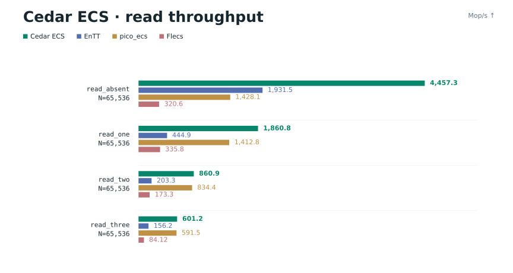
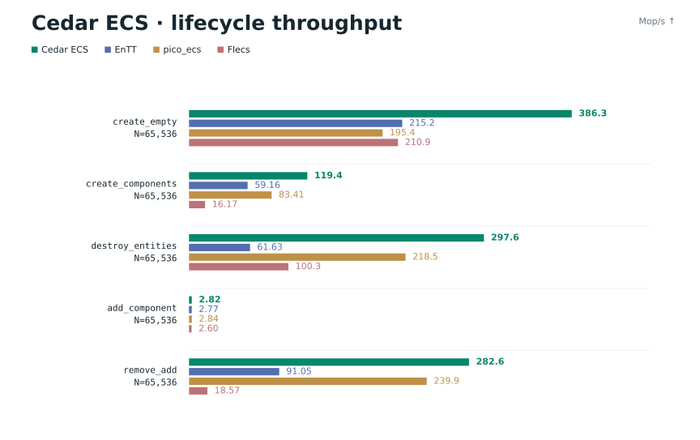
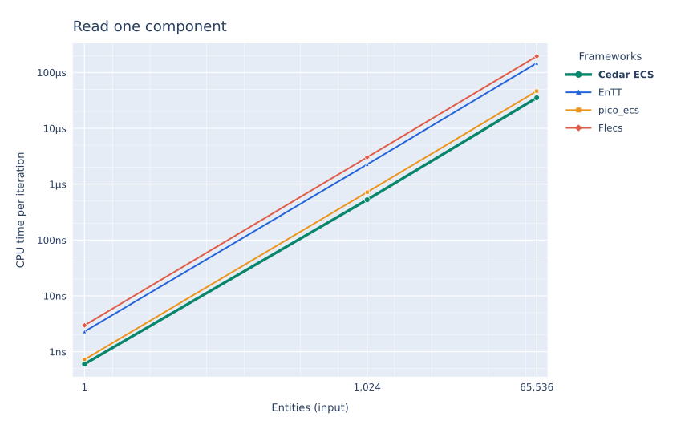

# Cedar ECS

A fast C11 entity component system with typed components, cached queries and
parallel iteration.

[Quick start](#quick-start) · [Benchmarks](#benchmarks) · [API guide](API_GUIDE.md) · [Reference](docs/REFERENCE.md)

- Packed archetypes or entity-indexed storage, chosen per world.
- Initialized spawning, reusable bundles and filtered views.
- Deferred commands from multiple producers and a persistent worker pool.
- Generational handles, checked access and zero-sized tags.

## Quick start

Clone Cedar with its [Kama](https://github.com/Dizabanik/kama) submodule:

```sh
git clone --recurse-submodules https://github.com/Dizabanik/cedarecs.git
cd cedarecs
make example
```

With a C11 compiler and Make on macOS or Linux, this prints `Position: 12, 20`.
The included [example](examples/quickstart.c) creates an entity and updates it:

```c
#include <cedarecs/cedar.h>
#include <stdio.h>

typedef struct Position { float x, y; } Position;
typedef struct Velocity { float x, y; } Velocity;
ced_slots_def(Position, Velocity)

int main(void) {
    ced_World *world = ced_world();
    ced_slot_init(world, Position);
    ced_slot_init(world, Velocity);

    ced_Entity entity = ced_spawn_with(world,
        ced_value(Position, {.x = 10, .y = 20}),
        ced_value(Velocity, {.x = 2, .y = 0}));

    ced_each(world, batch, Position, Velocity) {
        Position *p = ced_col(batch, Position);
        const Velocity *v = ced_col_const(batch, Velocity);
        ced_rows(batch, row) {
            p[row].x += v[row].x;
            p[row].y += v[row].y;
        }
    }

    const Position *p = ced_get_const(world, entity, Position);
    printf("Position: %.0f, %.0f\n", p->x, p->y);
    ced_drop(world);
}
```

Already cloned? Run `git submodule update --init --recursive` to fetch Kama.
For your app, see [manual compilation](docs/REFERENCE.md#building). Keep build
settings consistent across translation units.

## Benchmarks

**82 wins out of 84 entity matchups** against EnTT, pico_ecs and Flecs in the
measured suite. It covers creation, destruction, component changes and reads.

| Compared with | Cedar median wins |
| --- | ---: |
| EnTT | **27 / 28** |
| pico_ecs | **27 / 28** |
| Flecs | **28 / 28** |





The entity suite uses checked indexed access at 1, 1,024 and 65,536 entities,
plus empty-world lifecycle. Results are medians from 32 process rounds on an
Apple M4 Pro running macOS. Empty-world lifecycle loses to EnTT; adding a
component at the largest input loses to pico_ecs by 0.48%, with overlapping
timing ranges.

[Entity result tables](benchmarks/entity-tables.md) ·
[All 28 cases](assets/benchmarks/comparison-entities.svg) ·
[Scaling curves](assets/benchmarks/scaling-entities.svg)

<details>
<summary>Entity scaling example</summary>



Both axes are logarithmic. Lower time is better; markers show the three measured
inputs, and bands show timing quartiles.

</details>

The native C suites compare Cedar with Flecs across another 822 configurations:

| Suite | Cedar median wins |
| --- | ---: |
| Original | **47 / 50** |
| Packed | **345 / 386** |
| Indexed | **304 / 386** |

[Complete 850-case image](assets/benchmarks/comparison-complete.png) ·
[Native timing tables](benchmarks/complete-timings.md) ·
[Memory comparison](assets/benchmarks/memory.svg) ·
[Methods and limitations](benchmarks/README.md)

The C suites use 24 process rounds. Memory tradeoffs and remaining timing
regressions are documented in the methods; these results describe the tested
workloads, not a universal ranking.

## Everyday API

| Task | API |
| --- | --- |
| Add or replace a value | `ced_set(world, entity, Type, {...})` |
| Read a component | `ced_get` / `ced_get_const` (NULL when absent or invalid) |
| Add or remove a component or tag | `ced_add` / `ced_remove` |
| Delete an entity | `ced_kill(world, entity)` |
| Queue a structural change | `ced_defer_set`, `ced_defer_remove`, `ced_defer_kill`, then `ced_flush` |

Use `ced_each` for cached iteration. Keep explicit views or prepared spawn plans
in application state when reusing them. The [API guide](API_GUIDE.md) covers
filtered queries, registration helpers, bundles and repeated spawning. It also
includes [runnable examples](examples/).

## Storage and threads

`ced_world()` uses packed archetype storage. Use `ced_init_indexed()` when
component lookup and structural changes matter more than compact iteration.
Indexed storage can use more memory for sparse entity slots.

Only the owner thread changes structure or frees the world. During iteration,
queue structural changes and flush afterward. Structural changes can invalidate
borrowed component and batch pointers. Join external threads before dropping
their world.

`ced_set_threads` and `ced_parallel_each` split a view across workers. Callbacks
must use disjoint rows and synchronize shared application state. See the
[threading contract](docs/REFERENCE.md#deferred-commands-and-threads).

### Ordinary, concurrent or auto Kama?

This setting controls the producer registry, not the storage backend. Auto
starts with ordinary Kama and allocates concurrent shards after detecting
repeated producer switching. It is the default for its startup and memory
tradeoff; **it is not the fastest mode in every benchmark**.

| Compile setting | Registry mode |
| --- | --- |
| `-DCEDARECS_CONCURRENT_REGISTRY=0` | Ordinary |
| `-DCEDARECS_CONCURRENT_REGISTRY=1` | Concurrent |
| `-DCEDARECS_CONCURRENT_REGISTRY=2` | Auto (default) |

Apply the setting to every runtime source. For a known workload, compare forced
modes. [Measurements and policy details](docs/REFERENCE.md#registry-policy)
explain where auto wins and loses.

## Further reading

- [API guide and examples](API_GUIDE.md)
- [Lifetimes, errors, storage internals and C++ access](docs/REFERENCE.md)
- [Benchmark methods and complete results](benchmarks/README.md)

Recompile callers when updating Cedar; exposed struct layouts have no stable
binary interface. Memory optimizations remain experimental. Win32 support is
present but has not been validated in this benchmark run.
