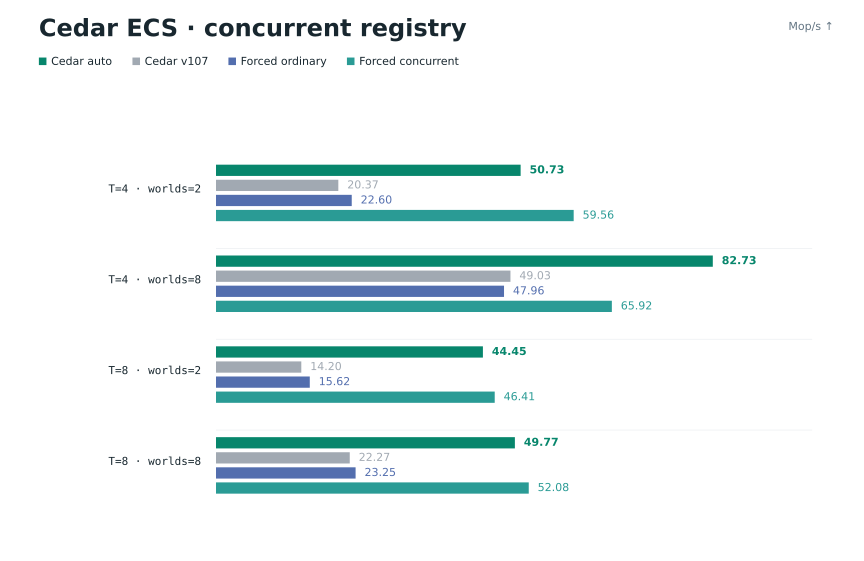

# Cedar ECS reference

[Quick start](../README.md#quick-start) · [API guide](../API_GUIDE.md) · [Benchmarks](../benchmarks/README.md)

- [IDs, registration, and tags](#ids-registration-and-tags)
- [Views and lifetimes](#views-and-lifetimes)
- [Deferred commands and threads](#deferred-commands-and-threads)
- [Parallel batches](#parallel-batches)
- [Systems and timing](#systems-and-timing)
- [Build, errors, and compatibility](#build-errors-and-compatibility)
- [Storage and dispatch internals](#storage-and-dispatch-internals)
- [Optional indexed storage](#optional-indexed-storage)
- [Prepared mutable access and initialization](#prepared-mutable-access-and-initialization)
- [Tracked checked readers and automatic batches](#tracked-checked-readers-and-automatic-batches)
- [Registry policy](#registry-policy)
- [Allocation and ownership](#allocation-and-ownership)
- [Building](#building)
- [Manual spawning example](#manual-spawning-example)

## IDs, registration, and tags

Entity handles encode a 32-bit slot and a 32-bit generation. Use `ced_is_alive`, `ced_entity_index`, `ced_entity_generation`, and `ced_alive_count`. Destroying twice is harmless; stale handles and their deferred commands cannot affect a replacement entity. Slots are retired instead of wrapping generations. Handles belong to their originating world; two worlds can issue numerically equal handles.

Components are world-local. `ced_slot_init` registers by name, size, and `_Alignof(Type)`; repeated registration is idempotent, and incompatible registration returns `ced_component_none`. Slot hints begin at that sentinel and are atomic. Typed operations resolve against the supplied world, even when worlds register types in different orders. Use `ced_type_id(world, Type)` for low-level calls; `ced_id(Type)` is only the last global hint and is unsuitable as a world-independent ID. Component names must identify unique types across the application.

Raw registration is available through `ced_component_init` (unnamed, alignment 1) or `ced_component_register` (named and aligned). The latter copies its name. An unregistered type cannot silently alias component zero. `ced_component_find` and `ced_component_name` support tools. Registration must finish before starting readers or command producers on that world.

Tags have size zero:

```c
ced_slot_def(Sleeping) // no Sleeping struct is needed
// During registration:
ced_tag_init(world, Sleeping);
ced_add(world, e, Sleeping);
if (ced_has(world, e, Sleeping)) { /* ... */ }
```

Tags have presence without data: ID-based `ced_get_component` / `ced_batch_col` return NULL. Values are byte-copied, zero-initialized C data; the ECS does not call constructors, destructors, or free pointees in components.

## Views and lifetimes

`ced_each` owns no static global cache. Each world/thread reuses a view for its ordered type list; the world releases it. Explicit `ced_view` / `ced_view_init` views can be released early with `ced_view_free` and are otherwise freed with the world. A view stays bound to its original world. Do not use it after world destruction.

`ced_view_each` and `ced_view_count` refresh automatically. `ced_view_refresh` is available to users inspecting `view->matches` directly. Refresh discovers new archetypes incrementally and skips pointer/count rebuilding if storage has not changed. Iteration skips empty archetypes; `break`, `continue`, and nested iteration work normally. `ced_entity_at` returns `ced_entity_none` for an invalid row.

```c
ced_Component required[] = {ced_type_id(world, Position)};
ced_Component excluded[] = {ced_type_id(world, Sleeping)};
ced_Component alternatives[] = {ced_type_id(world, Velocity)};
ced_View *active = ced_view_init(world, &(ced_ViewDesc){
    .all_count = 1, .all = required,
    .none_count = 1, .none = excluded,
    .any_count = 1, .any = alternatives,
});
ced_view_each(active, batch) { /* use ced_col(batch, Position) */ }
ced_view_free(active);
```

`all` defines required columns and `column_ptrs` order; `none` excludes archetypes; `any` requires at least one listed component. Empty `any` imposes no requirement. `ced_col` can access an optional component not listed in `all`, returning NULL for an absent one. Duplicate or invalid IDs in a filter/list are rejected. `ced_view_from_ids(world, 0, NULL)` matches every live entity, including entities without components.

**Structural changes invalidate component pointers, batch pointers, row indices, and query snapshots.** Creation, destruction, add/remove, and reserve may relocate or compact storage. Never perform them during an active iteration; enqueue changes and flush afterward. Updating an already present value keeps storage stable. Swap removal preserves entity identity but does not preserve iteration order. Entity arrays are metadata; do not modify their contents.

Large indexed worlds can keep required-column bindings in one query-owned
arena instead of allocating them for each run. Small worlds and single-field
queries use the per-run layout. Cedar chooses the layout when it sets up or
refreshes the view, outside the row loop. Rows keep native allocation alignment.
Storage shrinks or is freed as matches disappear. Run boundaries, optional
access and tag checks work the same way, and structural changes invalidate
cached bindings.

## Deferred commands and threads

In both storage modes, an adjacent add/put/write followed by removal of the
same initially absent component leaves the entity unchanged. Cedar checks the
full handle before skipping this pair. It needs no temporary component storage,
scratch-array or mask work, or revision change. Existing components, different
components, reversed operations and destruction follow normal command
processing. Enqueueing still validates and copies supplied values.

Each world's producer registry starts with ordinary Kama under the world mutex.
When TLS misses find an existing buffer and at least two producers are
registered, owner switches increase a score. At 64, the registry promotes once
to `kama_conc_u64`; repeated access by the same owner reduces the score.
Registration alone or a sole active producer does not trigger promotion.
The decision uses the lock already needed for lookup. Repeated access to one
world checks the TLS identity and returns the buffer without a mode check,
timer, sampling counter or map lookup.

The ordinary map is embedded in the private runtime. Automatic selection uses
16 logical bytes at its end, without moving hot fields. On the tested host,
the world stays in the same allocator size class. Automatic selection needs no
extra allocation before promotion. It allocates concurrent shards and their
handle when sharing is observed.
Cedar migrates entries under the world mutex, then publishes the map with
release/acquire ordering. Waiters recheck that pointer before using the old
map. Buffers and views stay at the same addresses, and the registry stays
concurrent until the world is destroyed. Every 256 misses by the same owner
reduce the score, so short lock convoys can still show sharing. TLS identity,
buffer and token share one thread-local object, resolved once per lookup.
Only registry synchronization changes; the structural-mutation rules still apply.

No build option is needed. `CEDARECS_CONCURRENT_REGISTRY` defaults to `2`
(automatic); `0` forces ordinary Kama and `1` forces concurrent Kama for controlled
experiments or known workloads. `CEDARECS_REGISTRY_SHARDS` defaults to 8 and must
be a positive power of two. All runtime translation units must agree.

The world mutex protects list publication and flush snapshots; each producer
queue also has its own mutex. In the twelve-producer test, registry tables
and control storage request 3,776 bytes per world with concurrent Kama, versus
288 bytes with the ordinary map. These figures describe the v107 forced modes.
Automatic mode uses another 16 bytes of runtime control and allocates a separate
concurrent handle after promotion. Command buffers and allocator overhead add
to those totals. The parent engine checkout runs this test with
`make -C testing check-concurrent-registry`.

Register types and create initial entities on the owning thread. Concurrent readers require stable structure. Give each thread its own explicit view, or use `ced_each` for an automatic per-thread cache. Concurrent writes require disjoint component storage; callbacks and application-owned state need their own synchronization.

```c
ced_each(world, batch, Position) {
    Position *p = ced_col(batch, Position);
    for (size_t i = 0; i < ced_len(batch); i++)
        if (p[i].x < 0) ced_defer_kill(world, ced_entity_at(batch, i));
}
ced_flush(world);
```

`ced_defer_add`, `ced_defer_remove`, `ced_defer_set` (upsert), `ced_defer_write` (existing only), and `ced_defer_kill` enqueue from multiple threads. Value bytes are copied immediately into reusable arenas, so stack/compound-literal values are safe. There is no fixed 32-thread limit. Buffers are registered per world and actual thread lifetime; switching worlds and allocator address reuse cannot reuse a stale TLS buffer. Buffers remain allocated until the world is dropped, so long-lived worker threads are preferable to spawning unbounded transient threads.

Only the owning thread may flush, discard, register, create, destroy, resize the worker pool, or free the world. It must wait for readers/writers of component storage before structural changes. Queue-only producers may continue enqueueing during a flush: each queue is swapped under its own mutex, and later commands remain for the next flush. Commands preserve FIFO order within a producer; ordering between producers is unspecified. Avoid conflicting cross-producer writes when deterministic results matter. `ced_discard_commands` clears queued work without applying it. Dropping the world frees pending payload arenas without executing commands. Join all external threads before dropping the world.

## Parallel batches

```c
static void integrate(ced_World *world, const ced_Batch *batch, void *context) {
    float dt = *(const float *)context;
    Position *p = ced_col(batch, Position);
    const Velocity *v = ced_col_const(batch, Velocity);
    for (size_t i = 0; i < ced_len(batch); i++) {
        p[i].x += v[i].x * dt;
        p[i].y += v[i].y * dt;
        if (p[i].x < 0) ced_defer_kill(world, ced_entity_at(batch, i));
    }
}
// Owner thread, outside an existing iteration:
ced_set_threads(world, 4); // total includes caller; 1 selects serial execution
ced_View *moving = ced_view(world, Position, Velocity);
float dt = 1.0f / 60.0f;
ced_parallel_each(moving, 1024, integrate, &dt);
ced_view_free(moving);
```

The pool persists between calls. Dispatch refreshes the view, splits each archetype into non-overlapping row slices, lets the caller participate, waits for all workers, then flushes deferred commands. `entities`, `column_ptrs`, `ced_col`, and `ced_entity_at` refer to the slice. `grain == 0` selects 1024 rows. Empty views succeed without invoking the callback. Context and slice pointers need only remain valid until the call returns.

An empty view or a single complete batch fitting the requested grain can finish
on the caller without waking idle workers. The configured thread count stays
unchanged. Callback scratch metadata remains private, structural-write exclusion
still applies, and deferred commands are flushed before dispatch returns.

Direct structural writes are rejected during parallel dispatch; use deferred
commands. Nested or concurrent dispatch on the same world returns false.
Pool sizes 1 to 256 are supported; invalid sizes and thread creation failures
return false. The owner thread sets up the pool and dispatches work. A parallel
callback must not refresh or free the dispatched view, destroy its world, or
read or write rows that another callback may modify. Deferral does not make
unrelated globals, game chunk storage, or rendering APIs thread-safe.

The system scheduler runs sequentially. Use parallel batch iteration inside a
system when its data can be partitioned safely. Scheduling whole systems
concurrently would require explicit read, write and resource declarations.

## Systems and timing

`ced_on_start`, `ced_on_update`, `ced_on_fixed`, and `ced_use` preserve the existing registration syntax. Default `ced_run` executes registered start systems and then uses a monotonic clock for frame deltas. Custom start/update hooks replace the defaults; a custom start hook should call `ced_start` when it wants registered startup systems to run. Set `world->ecs_quit = true` to request exit (the flag is atomic). Callback return values are currently reserved/ignored.

`ced_update_frame` first runs fixed systems, then update systems, then flushes. `ced_add_fixed_system(world, fn, step)` uses a constant step with at most `ced_max_fixed_steps` catch-up invocations per frame; excess backlog is discarded while preserving the fractional remainder. `ced_on_fixed` uses 1/60 second. `ced_add_update_system_capped` runs at most once per frame with the actual elapsed time since its previous call. Scheduling remainder is separate from elapsed time, preventing time from being counted twice. Negative or nonfinite frame deltas are rejected. Systems registered during a stage begin on the next execution of that stage. Start systems flush at the end of startup.

## Build, errors, and compatibility

In the parent engine checkout, `make test-ecs`, `make test-ecs-asan`,
`make test-ecs-tsan`, and `make test-ecs-config` test the ECS and containers
without graphics dependencies. `make test-chunks` links the engine and tests
chunk lookup, eviction and persistence against a temporary file without opening
a window. `make` builds the game. Header dependency files prevent stale
objects after API or layout changes.

Invalid handles, IDs, filters and registration requests return false, NULL or a
sentinel; void operations ignore them. Allocation failure or allocation-size
overflow aborts the process. Errors cannot silently publish a partially
allocated world or discard an old column. Callers cannot recover from
allocation errors through this API.

Recompile all consumers when updating this variant: exposed struct layouts,
the slot atomic type, archetype IDs and entity reuse semantics have changed.
The parent engine's `include/cedar/ecs.h` forwards to the ECS header with a
distinct include guard. Legacy `ihmap` and `dhasht` functions use Kama; direct
access to their old storage layout is unsupported. `wexds.h` documents value
ownership. String keys are copied; values remain caller-owned unless a
`*_wdata` destructor or removal is explicitly used.

The parent engine's `docs/ecs-audit.md` records the source audit, implemented
fixes and remaining design work.

## Storage and dispatch internals

Use `ced_spawn_plan_init(world, count, ids)` and
`ced_entity_from_plan(world, &plan)` to create entities repeatedly from a
signature validated once. `ced_reserve_plan` is optional; benchmarks do not reserve row
capacity. Plans carry the world's unique identity and are rejected by foreign
or replacement worlds. They expire when their world is dropped.

Entity records store an archetype pointer, uint32 row, and uint32 generation.
NULL archetype denotes a dead record; live empty entities still occupy the empty
archetype. The global entity limit guarantees rows fit uint32. Records beyond
entity_count are not initialized and must not be inspected. Compact records,
public C11 inline get accessors, and one-pass setter resolution retain handle,
component, tag, and overlap checks. Out-of-line getter symbols remain available.
All consumers must be recompiled for changed exposed layouts.

Columns use power-of-two row capacities. Fundamental-alignment allocations use
malloc/realloc so an allocator can extend or remap storage; over-aligned columns
retain aligned allocation and a copy fallback (Win32 uses aligned realloc).

Parallel dispatch caches slices by unique view identity, storage revision, and
grain. Scratch pointer arrays persist per worker. Atomics for generation, job
claims, and completion use separate cache lines. Callbacks still receive at most
the requested grain, with the same entities and component offsets as before.
Workers spin for up to 64 microseconds between closely spaced dispatches, then
park on a condition variable; define ced_worker_spin_us=0 for parking without
the active-wait budget. This trades some CPU/energy use for lower repeated-frame
latency. Idle workers do not spin indefinitely. Queries, structural changes,
grain changes, and pool resizing invalidate the relevant cached work.

`ced_field(batch, Type, index)` and `ced_field_const` access a required column
already bound in query order, like an ordinal field accessor. The caller must
supply the type corresponding to that required-field index. Invalid indices
return NULL. Optional component access remains available through ced_col.
Parallel dispatch keeps compact 24-byte slice descriptors and binds fields into
worker-local scratch from the query's cached base pointers and element sizes.
This avoids a large per-job batch/column cache and repeated component-ID lookup.

Worker counters are separated by 128 bytes on Apple ARM64 and 64 bytes
elsewhere. `ced_worker_cache_line` can override this private runtime setting.
The separation keeps claim and completion counters off the same cache line
on this machine, which has 128-byte cache lines. Each worker reuses scratch
storage sized by the query's field count, independent of its number of slices.

Completion uses a sequentially consistent waiter/completion handshake: the
last worker takes the condition-variable mutex only if the owner may sleep.
Either that worker observes the wait flag or the owner observes completion
before sleeping, preserving notifications while avoiding an unconditional
completion lock on every frame. Active polling checks the clock in batches.

Parallel jobs start in contiguous per-worker ranges. Workers claim from their
own cache-line-separated cursor, then steal unclaimed ranges from peers. This
reduces shared-counter contention while preserving exact slice boundaries and
balancing unequal callback/core throughput. Queues are reset only after every
participant has completed the previous generation.

Serial dispatch initializes batch metadata once per archetype and advances its
field pointers between slices. It retains the requested grain and callback
boundaries while avoiding repeated full batch copies and base-pointer binding.


Deferred flush folds consecutive commands for the same generational handle into
one final signature and at most one migration. It preserves per-producer FIFO
outcomes, including set-on-absent, remove/re-add zero initialization, and kill.
Intermediate archetypes and row ordering are not observable guarantees. Separate
entities and producer queues are never reordered. Command records are 24 bytes
on 64-bit targets; payload sizes come from immutable component registrations.

`ced_commands_begin(world)` / `ced_commands_end(world)` are optional nestable
producer scopes that hold that producer's queue mutex across a group of writes.
End scopes on the same thread before waiting for another thread to flush; the
world owner may flush its own open scope. Ending does not flush. Ordinary writes
still lock individually and remain safe alongside concurrent owner snapshots.
Each scope must be closed before destroying the world or exiting its thread.

`ced_entity_from_plan_values(world, &plan, values)` initializes data directly
without first zeroing it or moving through intermediate signatures. `values`
contains one pointer per component in ascending component-ID order (the plan's
canonical archetype type order). NULL entries zero-initialize; tags ignore their
entries. Source values can alias component storage, even when insertion grows
those columns. `NULL` for the entire array retains zero-initialized creation.
Presence access uses an inline membership check, including for tags, without
building a nullable data-column pointer. It still checks the handle.


`ced_read_access(world)` returns a non-owning metadata interface usable with the
plain C/C++ header `cedarecs/access.h`. `ced_read_get(&access, entity, component)`
validates live generations and IDs inline and follows the world's record-array
growth. It returns const data; tags and absent data return NULL. Access objects
expire when their world is destroyed. Component pointers retain the ordinary
structural-write lifetime and threading rules. The metadata points at actual
shared C subobjects; it does not assume a C++ layout for C atomics or hashmaps.
The optional read facade adds two pointers per archetype, with no record growth.

Each archetype has a Kama transition map and a cache of eight recent edges by
component ID. Cache collisions fall back to Kama without affecting correctness.
Each query owns its dispatch slices, reuses them across pool resizing and frees
them when the query is freed. Alternating systems keep separate plans. A
dispatched query stores O(entities/grain) slices; structural revisions and grain
changes rebuild them.


## Optional indexed storage

`ced_init_indexed()` selects entity-indexed component arrays for a world. Entity
slots retain their generational handles; component presence stores the complete
64-bit owner handle separately from payload data. UINT64_MAX marks absence:
entity index UINT32_MAX is never allocated, so this marker cannot alias a live
entity, including at generation UINT32_MAX. Presence metadata costs eight bytes
per allocated slot, including the four-byte index as well as the generation.
Checked reads compare the complete owner without an overflow slow path.
Structural changes update signatures
without copying retained components or compacting component rows. A component
allocates slots lazily on its first insertion and grows with the world's entity
capacity. This trades additional memory in unused slots and presence arrays for
cheaper random reads and structural changes. The default remains archetype
storage, which packs iteration data and handles fragmented signatures better.

`ced_indexed_reader(world, component)` binds a non-owning reader. Its metadata
survives allocation growth; `ced_indexed_get(&reader, entity)` validates presence
and the complete generation before returning const data. Tags return NULL.
Readers expire with their world. Ordinary get/set/defer/query/worker APIs also
support indexed worlds. Queries expose contiguous live runs with matching
signatures, including correct AND/NOT/any/optional filters and holes from
removed entities. Empty indexed queries expose no live runs. Iteration order is
unspecified. Borrowed component pointers follow the usual growth/lifetime rules.


`ced_indexed_write_begin(world)` opens an owner-only mutation scope. Bind a
component with `ced_indexed_bind(&writer, component)`, then use
`ced_indexed_add` (idempotent, zero on first add) and `ced_indexed_remove`.
Changes are immediately visible to ordinary accessors and queries. Bindings
cache signature transitions, retain full generation validation, and follow
allocation growth. End with `ced_indexed_write_end(&writer)` before dispatching
workers. Worker dispatch is rejected while any writer is open. Keep scopes and
bindings at stable addresses, do not copy active scopes, and close every scope
before dropping its world. C++ `ced_IndexedRead<T>` and `ced_IndexedMutate<T>`
check the bound byte size once and use a constant stride; reads return bytes
for copying into live C++ objects. The scope API does not expose C atomic or
hashmap layout to C++ callers.

The world, runtime, component metadata, empty signature, and small initial
entity and archetype arrays share one allocation. Larger arrays use separate
checked allocations. Short component names live inside stable metadata;
long names have separately owned storage. Small-world teardown frees fewer
allocations in both storage modes; lifetime rules are unchanged.


C++ `ced_IndexedRead<T>::value(entity)` validates the handle and returns a copied
value without invoking a component default constructor. The explicitly named
`value_unchecked(entity)` is for callers that already guarantee the entity is
live, owns the component in this world, and remains valid during the read. It
performs no generation, presence, or bounds checks. Its contract matches raw
indexed getters; use checked `get`/`value` otherwise. Benchmarks of this path
must be reported separately from checked access.


## Prepared mutable access and initialization

Bind `ced_Access access = ced_access(world)` once, then call
`ced_access_get(&access, entity, component)` for checked mutable access. It
follows record-array growth and validates the complete entity generation and
component presence. Invalid, stale, absent, and tag reads return NULL. Bindings
expire with their world; returned pointers expire on structural changes. Use the
same owner/disjoint-worker synchronization rules as `ced_get_component`. Binding
an accessor does not open an indexed write scope or exclude worker dispatch.
`ced_ReadAccess`/`ced_read_get` provide the const-world counterpart.

Packed signatures with eight or more data columns zero unused capacity in bulk;
smaller signatures clear each exposed row. A high-water boundary
tracks rows that may contain old data; recycled rows are still cleared before
being exposed. Prepared value spawning overwrites supplied values and preserves
zeroes for missing values. Homogeneous 8 to 256-byte signatures resolve their
initialization width once per row. Mixed widths, tags, arbitrary sizes and
alignment keep their general behavior. Clang inline memory builtins prevent
small memory operations from becoming external calls; other compilers use
ordinary memset/memmove. `CEDARECS_PORTABLE_MEMORY` forces that fallback for
validation. Small copies capture all source bytes before writing, so
overlapping memory has memmove semantics. Capacity growth can zero more memory
in bulk and keep a larger working set. The throughput effect depends on the
workload.


## Tracked checked readers and automatic batches

`ced_IndexedRead<T>` keeps bounds, the complete 64-bit generation/owner check,
and byte-size validation. Its allocation snapshot is refreshed by the engine
when indexed storage grows. Copies, moves and assignments re-link the reader;
world destruction invalidates tracked readers, so subsequent `get` calls return
NULL and required `value` calls abort. Const readers use mutable registration
metadata, without making component data mutable through their read interface.
Registration of independent objects is synchronized. Component reads still
require the world's normal synchronization; join external users before freeing
its world. Borrowed raw pointers still expire on structural changes.
The raw C `ced_IndexedReader` and `ced_ReadAccess` retain their world-bound lifetime.

C callers can zero-initialize `ced_IndexedAccess`, initialize it with
`ced_indexed_access_init`, copy with `ced_indexed_access_copy`, and reset before
its address expires. Do not copy an active C node with struct assignment or move
its storage directly. The C++ wrapper handles these operations automatically.

`ced_indexed_prepare(&binding)` explicitly reserves component storage and caches
an empty/single-component transition for repeated writes. It requires an active
indexed writer. Like other reserve operations, it may invalidate borrowed
pointers; it does not make the component present on any entity.

`ced_parallel_each_auto(view, callback, context)` uses one complete matching
batch per archetype/run with one thread and balanced chunks across workers
otherwise. It shares all validation, writer exclusion, completion and deferred
command processing with `ced_parallel_each`. The explicit-grain API still limits
every callback to the supplied maximum, including its 1024-row default for zero.
Automatic batching is an explicit API choice and promises no particular maximum.

Stable serial dispatches cache complete field bindings. Structural revisions or
grain changes invalidate them; frequently changing dispatches use the ordinary
binding path. Iterators snapshot their match pointer/count at begin. Construct
iterators with `ced_iter_begin` and do not change structure or destroy the view
while iterating. Batch field bounds are copied from validated, immutable query
arity. Batch counts use 32 bits, matching the world's existing entity-index
limit; field and handle checks remain active in release builds.

Packed column starts are spaced by cache lines, with true allocation bases kept
separately for resize/free. Offsets honor component alignment and `ced_align`.
Padding and serial batch metadata use additional memory. Rebuild all consumers
after changes to these exposed layouts.

In this experimental memory variant, entity records use native allocations up
to and including 1 MiB. The next growth moves initialized records into a
growable virtual allocation on supported platforms. This keeps allocator page
reuse at the geometric-growth boundary while retaining bounded growth for
larger worlds. Full-width generations, handles and record checks are retained.
`CEDARECS_NO_VM` uses native allocation throughout.

Both `ced_IndexedRead<T>` and `ced_IndexedAccess` occupy six pointer-sized words
(48 bytes on 64-bit platforms). The typed wrapper adds no alignment padding or
storage. Rebuild consumers after storage layout changes.

Indexed edges cache one immutable changed-component descriptor in place of an
unused packed column map. A single-component transition updates only that
owner slot and the two archetype counts; shared components stay in place. The
public component mutation functions and packed move path retain their original
implementation. Bounds, full generations, owner handles, alias capture, zero
initialization, query revisions and tracked-pointer refresh remain checked.

Indexed owners retain full 64-bit generational handles for every component.
Checked C and C++ reads compare one owner value, without format selection or
special final-generation storage. Every generation remains usable and slot
retirement prevents wrapping. `ced_indexed_contains(&reader, entity)` checks
presence, including zero-sized tags.

Large indexed columns grow to their highest published entity slot, independently
of unrelated empty-entity creation. Small components retain pool-wide growth.
Each signature caches its common prepared prefix; creation and cached writable
bindings grow storage before publishing a slot outside that prefix. Initialized
spawn inputs are captured before any growth that could relocate them. Explicit
`ced_reserve_archetype`, `ced_reserve_plan` and `ced_indexed_prepare` continue to
prepare their components through the requested pool capacity. This bounds a
prefix; sparse high-slot components can still require large allocations.

Owner arrays use `ced_Entity` entries. Tracked readers refresh on relocation
and invalidate on world destruction. Detached snapshots do not extend foreign
metadata lifetimes. The checked facade uses the same six-word layout.
The memory experiments remain under evaluation; no complete timing or memory
acceptance has been established.

`ced_indexed_put(&binding, entity, &value)` and C++ `ced_IndexedMutate<T>::put`
validate the live handle and active write scope. They capture inputs that may
alias a large column before growing it. A prepared put retains the inline
path. C puts accept NULL only for zero-sized tags.

## Registry policy

`CEDARECS_CONCURRENT_REGISTRY` selects the command-producer registry. It does
not change entity storage, query semantics or the rules for structural writes.
Use the same setting when compiling every Cedar runtime file.

| Value | Policy | Tradeoff |
| --- | --- | --- |
| `0` | Ordinary Kama | Avoids shard allocations; shared lookup uses the world mutex. |
| `1` | Concurrent Kama | Allocates shards on first use; usually faster when producers switch between worlds. |
| `2` | Automatic (default) | Starts ordinary and promotes after repeated producer switching. |

Automatic mode is a general default, not a fastest-mode selector. In the saved
24-case registry suite it beats ordinary mode in 20 cases and concurrent mode
in 9. Forced concurrent wins the other 15 comparisons. The largest automatic
penalty is 60.6%: 22.19 versus 13.81 ns/operation with two threads, eight worlds
and empty command scopes. These are registry microbenchmarks, not full ECS frames.

There is a startup tradeoff. Creating, opening a command scope and dropping a
world takes 126.63 ns with auto versus 206.86 ns with forced concurrent in the
first-use test. Automatic mode also avoids shard allocations until promotion.
For a known workload, compare forced modes; the default is not guaranteed to
win. These measurements do not establish the fastest policy for another host.

To force concurrent mode, add `-DCEDARECS_CONCURRENT_REGISTRY=1` to **all**
runtime compile commands. Use `=0` for ordinary mode. `CEDARECS_REGISTRY_SHARDS`
controls the shard count and defaults to eight.



[Full registry comparison](../assets/benchmarks/concurrent-registry-complete.svg)

## Allocation and ownership

The world owns archetype metadata, including its type, column and allocation
pointer arrays. Those arrays share one allocation; callers borrow them and must
not free them separately. Component metadata stays at the same address as
registrations grow. Raw component pointers follow the structural-write lifetime
rules below. Tracked indexed readers follow storage when it moves.

Large buffers use anonymous mappings on macOS/Linux, normally reserving at
least 256 MiB of address space per buffer. Unused reservation is not physical
RAM. The allocator retries with an exact-size mapping under address-space
pressure. Define `CEDARECS_NO_VM` for native geometric allocation; other
platforms use this fallback automatically. Memory comparisons must include
mapped logical storage and process footprint alongside malloc statistics.

Kama's `put` reports success for both insertion and overwrite. Cedar's legacy
integer-map wrapper returns `entry.inserted`, so its boolean still means that
it inserted a new key. Internal code uses `put_unique` only after a lookup proves
the key absent while structural writes are excluded or the registry mutex is
held. Allocation failures and public inputs are checked.


## Building

The standalone `make example` target compiles and runs `examples/quickstart.c`.
To use your own build system, compile all `ecs/*.c` files and `wexds.c` with C11
and thread support. Include both the Cedar directory (for Kama) and its parent
(for the `cedarecs/` header namespace). For example, from the checkout root:

```sh
mkdir -p build
cc -std=c11 -O3 -DNDEBUG -pthread \
    -D_POSIX_C_SOURCE=200809L -D_DARWIN_C_SOURCE -I. -I.. \
    examples/quickstart.c ecs/*.c wexds.c -lm -o build/quickstart
./build/quickstart
```

Keep `ced_*`, `CEDARECS_*` and `KAMA_*` settings consistent across all runtime
translation units. Win32 allocation and synchronization code is present but was
not tested in this benchmark run.

## Manual spawning example

```c
#include <cedarecs/cedar.h>

typedef struct Position { float x, y; } Position;
typedef struct Velocity { float x, y; } Velocity;

// In a shared header use ced_slot(Position) / ced_slot(Velocity).
// Define each slot exactly once in a .c file:
ced_slot_def(Position)
ced_slot_def(Velocity)

int main(void) {
    ced_World *world = ced_world();
    ced_slot_init(world, Position);
    ced_slot_init(world, Velocity);

    ced_Entity e = ced_spawn(world, Position, Velocity);
    ced_set(world, e, Position, {.x = 10, .y = 20});
    ced_set(world, e, Velocity, {.x = 2, .y = 0});

    ced_each(world, batch, Position, Velocity) {
        Position *p = ced_col(batch, Position);
        const Velocity *v = ced_col_const(batch, Velocity);
        for (size_t i = 0; i < ced_len(batch); i++) {
            p[i].x += v[i].x;
            p[i].y += v[i].y;
        }
    }

    const Position *p = ced_get_const(world, e, Position);
    if (p && p->x > 100) ced_kill(world, e);
    ced_drop(world);
}
```
